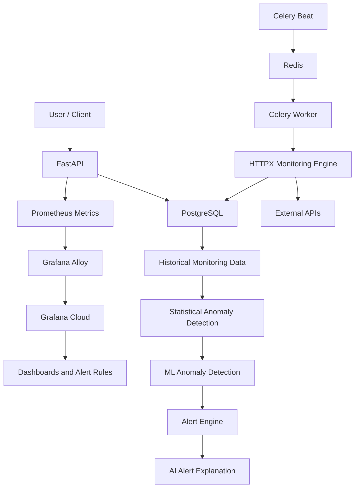
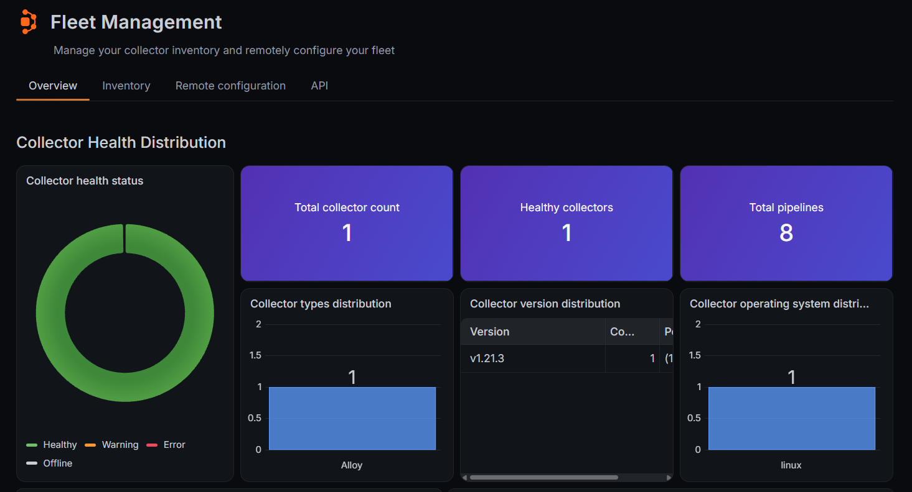

# API Sentinel

### Production-Ready API Monitoring, Observability & Anomaly Detection Platform

**Live Health Endpoint:** [https://api.apisentinel.dev/health](https://api.apisentinel.dev/health)

**GitHub Repository:** [API Sentinel – Source Code](https://github.com/DerekhChokhmah/40-days-Moses-coding-fast/tree/main/prototype/api-sentinel)

---

## 1. Project Overview

API Sentinel is a cloud-native API monitoring and observability platform designed to monitor HTTP endpoints, collect historical performance data, detect anomalies, and provide actionable alerts when monitored services become unavailable or experience abnormal behavior.

The platform combines asynchronous task processing, persistent monitoring history, statistical and machine-learning-based anomaly detection, and cloud-native observability.

### Key Objectives

- Automated HTTP endpoint monitoring.
- Scheduled monitoring using Celery Beat.
- Asynchronous monitoring execution using Celery workers.
- Persistent monitoring history using PostgreSQL.
- Redis-based task queuing.
- Statistical and machine-learning-based anomaly detection.
- Alert generation and AI-assisted alert explanations.
- Prometheus metrics collection.
- Grafana Cloud dashboards and alerting.
- Kubernetes-based deployment.

---

## 2. Live Deployment

| Resource | Link |
|---|---|
| API Health Check | [https://api.apisentinel.dev/health](https://api.apisentinel.dev/health) |
| GitHub Repository | [View Source Code](https://github.com/DerekhChokhmah/40-days-Moses-coding-fast/tree/main/prototype/api-sentinel) |
| API Documentation | `/docs` — protected by Cloudflare Access in production |
| Prometheus Metrics | `/metrics` — application metrics endpoint |

The public health endpoint provides a way to verify API availability.

---

## 3. System Architecture



### System Components

| Component | Responsibility |
|---|---|
| FastAPI | REST API and application endpoints |
| PostgreSQL | Monitoring configuration and historical results |
| SQLAlchemy | Database ORM and persistence |
| Redis | Celery message broker |
| Celery Beat | Periodic monitoring task scheduling |
| Celery Worker | Asynchronous monitoring execution |
| HTTPX | HTTP endpoint health checks |
| Prometheus | Application metrics |
| Grafana Alloy | Metrics collection and forwarding |
| Grafana Cloud | Visualization, observability and alerting |
| Kubernetes | Container orchestration |
| Google Kubernetes Engine | Cloud deployment infrastructure |
| Cloudflare Tunnel | External application access |
| Docker | Containerization |

---

## 4. Core Features

### 4.1 HTTP Endpoint Monitoring

Monitor external HTTP endpoints and collect:

- HTTP response status.
- Response time.
- Endpoint availability.
- Monitoring execution results.
- Historical monitoring information.

### 4.2 Automated Scheduling

Celery Beat periodically dispatches monitoring tasks.

Celery workers execute monitoring jobs asynchronously, keeping long-running monitoring operations independent of API request handling.

### 4.3 Historical Data Persistence

PostgreSQL stores monitoring configurations and execution results.

The historical dataset provides the foundation for performance analysis and anomaly detection.

### 4.4 Anomaly Detection

The platform incorporates:

- Statistical anomaly detection.
- Machine-learning-based anomaly detection.
- Historical performance analysis.

### 4.5 Alert Management

API Sentinel generates alerts based on monitoring failures and detected anomalies.

AI-assisted explanations provide additional context to help interpret alerts.

---

## 5. Technology Stack

| Category | Technologies |
|---|---|
| Backend | Python, FastAPI |
| API communication | HTTPX |
| Validation | Pydantic |
| Database | PostgreSQL |
| ORM | SQLAlchemy |
| Migrations | Alembic |
| Task processing | Celery |
| Scheduler | Celery Beat |
| Message broker | Redis |
| Monitoring | Prometheus |
| Metrics collection | Grafana Alloy |
| Visualization | Grafana Cloud |
| Containers | Docker |
| Orchestration | Kubernetes |
| Cloud infrastructure | Google Cloud Platform, GKE |
| External access | Cloudflare Tunnel |

---

## 6. Database Architecture

The application uses PostgreSQL for persistent storage.

Core database tables include:

| Table | Purpose |
|---|---|
| monitors | Stores monitored endpoint configurations |
| monitoring_results | Stores historical monitoring execution results |
| alerts | Stores generated monitoring alerts |

SQLAlchemy handles database interactions, while Alembic manages database schema migrations.

---

## 7. Application Monitoring and Observability

API Sentinel exposes Prometheus-compatible application metrics through:

```text
/metrics
```

The metrics endpoint is instrumented using `prometheus-fastapi-instrumentator`.

### Metrics collected

- `http_requests_total`
- `http_request_duration_seconds_bucket`
- `http_request_duration_highr_seconds_bucket`
- `process_cpu_seconds_total`
- `process_resident_memory_bytes`

### Monitoring pipeline

```text
FastAPI
   |
   v
/metrics
   |
   v
Grafana Alloy
   |
   v
Grafana Cloud Prometheus
   |
   v
Grafana Dashboards and Alerting
```

Grafana Alloy scrapes application metrics every 30 seconds and forwards them to Grafana Cloud.

### Grafana Dashboards

The following individual dashboards were created:

1. API Availability
2. API Error Rate
3. API Process CPU Usage
4. API Process Memory Usage
5. API Request Latency
6. HTTP Request Volume by Endpoint
7. HTTP Response Status Distribution

A consolidated dashboard brings the monitoring visualizations together for an overall production observability view.

### Grafana Alerting

Three alert rules are configured:

| Alert | Condition | Pending Period |
|---|---|---|
| API Unavailable | Scrape value below 0.5 | 2 minutes |
| High HTTP 5xx Error Rate | Error rate above 5% | 5 minutes |
| High API Latency | p95 latency above 1 second | 5 minutes |

Email notifications are configured through a Grafana Cloud contact point.

The email contact point has been tested successfully.

---

## 8. Project Screenshots

Screenshots provide visual evidence of the deployed application, monitoring infrastructure and observability configuration.

All screenshot files are stored in the `screenshots/` directory.

### 8.1 Consolidated Grafana Dashboard


### 8.2 Individual Grafana Dashboards

#### API Availability


#### API Error Rate


#### API Process CPU Usage


#### API Process Memory Usage


#### API Request Latency


#### HTTP Request Volume by Endpoint


#### HTTP Response Status Distribution


### 8.3 Grafana Alert Rules


### 8.4 Grafana Email Contact Point


### 8.5 Kubernetes Deployment


### 8.6 FastAPI Swagger Documentation


### 8.7 Grafana Alloy Collector



---

## 9. Containerization

Docker is used to package application components into containers.

The platform includes separate application processes for:

- FastAPI application.
- Celery Beat scheduler.
- Celery worker.

PostgreSQL and Redis provide persistent storage and message-broker functionality.

Docker Compose is used for local multi-container development.

---

## 10. Kubernetes Deployment

API Sentinel is deployed on Google Kubernetes Engine.

### Deployment Components

| Workload | Purpose |
|---|---|
| api-sentinel-api | FastAPI application |
| celery-beat | Scheduled task dispatch |
| celery-worker | Asynchronous task execution |
| postgres | Persistent database |
| redis | Message broker |
| api-sentinel-tunnel | External application access |

### Kubernetes Capabilities

- Deployments and StatefulSets.
- ClusterIP services.
- ConfigMaps and Secrets.
- PersistentVolumeClaims.
- Container image management.
- Pod health and readiness verification.
- Application rollout and deployment management.
- Namespace isolation.

### Cluster Information

| Configuration | Value |
|---|---|
| Cloud provider | Google Cloud |
| Kubernetes service | Google Kubernetes Engine |
| Cluster | api-sentinel-gke |
| Region | asia-south1 |
| Namespace | api-sentinel |

### Useful Kubernetes Commands

Check application pods:

```bash
kubectl get pods -n api-sentinel
```

Check services:

```bash
kubectl get services -n api-sentinel
```

Check deployments:

```bash
kubectl get deployments -n api-sentinel
```

View API logs:

```bash
kubectl logs deployment/api-sentinel-api -n api-sentinel
```

Check deployment rollout:

```bash
kubectl rollout status deployment/api-sentinel-api -n api-sentinel
```

---

## 11. Local Development Setup

### Prerequisites

- Python
- Docker
- Docker Compose
- PostgreSQL
- Redis
- Git

### Clone the repository

```bash
git clone https://github.com/DerekhChokhmah/40-days-Moses-coding-fast.git
```

Navigate to the project:

```bash
cd 40-days-Moses-coding-fast/prototype/api-sentinel
```

### Configure environment variables

Create a `.env` file containing the environment variables required by the application.

Example:

```env
POSTGRES_PASSWORD=<YOUR_DATABASE_PASSWORD>
GEMINI_API_KEY=<YOUR_GEMINI_API_KEY>
```

Add any additional variables required by the application configuration.

Never commit `.env` files, API keys, database credentials or cloud access tokens.

### Start the application

```bash
docker compose up --build -d
```

Check running containers:

```bash
docker compose ps
```

View application logs:

```bash
docker compose logs -f
```

Stop the application:

```bash
docker compose down
```

---

## 12. API Health Verification

The deployed health endpoint is publicly accessible:

**[https://api.apisentinel.dev/health](https://api.apisentinel.dev/health)**

Test using curl:

```bash
curl https://api.apisentinel.dev/health
```

The application also exposes:

| Endpoint | Purpose |
|---|---|
| `/health` | API health verification |
| `/metrics` | Prometheus-compatible application metrics |
| `/docs` | FastAPI Swagger documentation |

Production documentation access may be protected by Cloudflare Access.

---

## 13. Security Considerations

- Avoid committing credentials to Git.
- Store API keys outside source code.
- Use Kubernetes Secrets for deployment credentials.
- Protect production documentation endpoints.
- Restrict access to monitoring infrastructure.
- Use authenticated cloud services for metrics ingestion.
- Rotate credentials if they are exposed.

---

## 14. Project Outcomes

API Sentinel demonstrates the integration of:

- REST API development.
- Asynchronous task processing.
- Database architecture and persistence.
- Scheduled background execution.
- HTTP service monitoring.
- Historical data processing.
- Statistical and machine-learning anomaly detection.
- Alert management.
- Prometheus instrumentation.
- Grafana Cloud observability.
- Docker containerization.
- Kubernetes orchestration.
- Google Cloud deployment.

The project brings together backend engineering, data engineering, machine learning, DevOps and production observability in one integrated system.

---

## 15. Project Status

| Attribute | Details |
|---|---|
| Project | API Sentinel |
| Category | Backend Engineering, MLOps, DevOps, Observability |
| Deployment | Google Kubernetes Engine |
| Monitoring | Grafana Cloud and Prometheus-compatible metrics |
| API Health | Public health endpoint |
| Alerting | Three configured Grafana alert rules |
| Email Notifications | Tested |
| Status | Core implementation and deployment completed; final documentation and verification in progress |

---

## Author

Developed as a production-oriented engineering portfolio project.

**Focus Areas:** Python Backend Development, API Engineering, Data Analytics, Machine Learning, DevOps and Cloud Infrastructure.

**Source Code:** [GitHub – API Sentinel](https://github.com/DerekhChokhmah/40-days-Moses-coding-fast/tree/main/prototype/api-sentinel)
